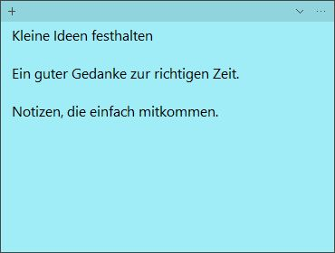
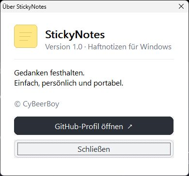

# StickyNotes

Kleine Gedanken verdienen einen festen Platz. StickyNotes bringt einfache,
farbige Notizzettel direkt auf deinen Windows-Desktop – ohne Installation und
ohne Konto. Jede Notiz ist ein eigenes Fenster, das du frei verschieben,
vergrößern oder platzsparend zusammenklappen kannst.

Über StickyNotes

**[StickyNotes herunterladen](https://github.com/cybeerboy/StickyNotes/releases/latest)** · Windows 64 Bit · portabel

Schreib dir Ideen auf, formatiere wichtige Stellen und behalte Bilder oder
PDFs direkt bei deinen Notizen. Deine Daten bleiben bei dir: Sie liegen in
`notes.dat` neben der EXE und wandern zusammen mit ihr auf einen anderen PC
oder USB-Stick. Für ein Backup genügt eine Kopie dieser Datei.

## Auf einen Blick

- Freie Fenster mit sechs Farben, Größenänderung und einklappbarer Vorschau
- Automatisches Speichern, Textformatierung, Aufzählungen und Suche
- Emoji-Eingabe über die Windows-Tastatur und Textdateien importieren/exportieren
- Bilder und PDFs als Anlagen mitnehmen, ohne die Originaldateien zu verändern
- Optional im Vordergrund oder halbtransparent anzeigen

## Erste Schritte

1. Lade `StickyNotes.exe` von der [Release-Seite](https://github.com/cybeerboy/StickyNotes/releases/latest) herunter.
2. Lege die Datei in einen beschreibbaren Ordner und starte sie per Doppelklick.
3. Schreibe los. Über `+` entsteht eine weitere Notiz, über `⋯` findest du die Einstellungen und Aktionen.

Eine ausführlichere Übersicht und Hinweise zur portablen Speicherung findest du unten.

Eine portable Windows-Anwendung für Haftnotizen auf dem Desktop. Jede Notiz ist ein eigenes Fenster. Die Release-Version benötigt keine Installation und keine separat mitzuliefernde DLL.

## Portable EXE

`build-release\StickyNotes.exe` ist die ausführbare Datei für 64-Bit-Windows. Die EXE in einen beschreibbaren Ordner auf dem Rechner oder USB-Stick kopieren und starten. Notizen liegen in `notes.dat` direkt neben der EXE; diese Datei zusammen mit der EXE kopieren, damit die Inhalte mitwandern. Sichere `notes.dat` regelmäßig als Backup. Nur eine Instanz kann gleichzeitig laufen.

Falls neben der EXE noch keine `notes.dat` liegt, übernimmt die Anwendung beim ersten Start eine vorhandene Datei aus `%LOCALAPPDATA%\StickyNotes\notes.dat`. Die alte Datei bleibt dabei erhalten. Bei fehlenden Schreibrechten wird die Übernahme abgebrochen. Kann eine vorhandene Datendatei nicht gelesen werden, meldet die Anwendung den Fehler und beendet sich, ohne die Datei zu überschreiben.

Beim Start entpackt die portable EXE die interne Anwendung und ihre Laufzeit vorübergehend in einen Windows-Tempordner; nach normalem Beenden werden diese Programmdateien entfernt. Die Notizen selbst bleiben neben der EXE. Beim Öffnen einer Anlage entsteht eine Kopie im Windows-Tempordner. Diese Kopie kann nach dem Schließen erhalten bleiben, und Änderungen daran werden nicht automatisch in der Notiz gespeichert.

## Bedienung

- An der Kopfleiste ziehen, um eine Notiz zu verschieben; die Fenstergröße lässt sich an den Rändern ändern.
- Ein Doppelklick auf die Kopfleiste oder ein Klick auf den kleinen Pfeil klappt die Notiz zusammen und wieder auf. Im Streifen steht eine Textvorschau.
- `+` erstellt eine neue Notiz. Über `⋯` erreichst du Suche, Textformat, Darstellung, Textdatei, Anlagen, Löschen und den Über-Dialog.
- Markierten Text kannst du fett (`Strg+B`), kursiv (`Strg+I`) oder unterstrichen (`Strg+U`) setzen. `Strg+Plus` und `Strg+Minus` ändern die Schriftgröße, `Strg+Umschalt+L` schaltet die Aufzählung um. `Strg+N` erstellt eine Notiz, `Strg+F` öffnet die Suche. Die Kürzel gelten, während eine Notiz aktiv ist. Segoe UI ist die Standardschrift.
- Emojis können eingefügt und gespeichert werden, zum Beispiel über die Windows-Emoji-Auswahl `Windows-Taste + .`. Die Darstellung hängt von Windows und den verfügbaren Schriftarten ab; Emojis können einfarbig erscheinen.
- Im Menü kannst du einzelne Notizen im Vordergrund halten oder halbtransparent anzeigen. `Als Standard verwenden` übernimmt Farbe, Fenstergröße und Optionen sowie das aktuelle Textformat für neue Notizen. `Notizen anordnen` platziert die Fenster auf dem primären Bildschirm.
- Die Suche findet den ersten passenden Text in der aktuellen oder in allen Notizen. Dabei wird eine zusammengeklappte Fundstelle geöffnet.
- Über das Menü lassen sich UTF-8-Textdateien importieren oder exportieren. Der Import ergänzt den Text am Ende der aktuellen Notiz. Passt der Text nicht vollständig in die Notiz oder enthält er Nullzeichen, wird nichts eingefügt. Beim Export wird nur Text gespeichert; Formatierungen und Anlagen bleiben in der Notizdatei. Bereits vorhandene Dateien werden nicht überschrieben.
- Bilder und PDFs können über `⋯ → Anlagen` hinzugefügt werden. Die Originaldatei wird nur gelesen und bleibt unverändert an ihrem Platz; eine Kopie des Inhalts wird in `notes.dat` gespeichert. Kopiere EXE und `notes.dat` zusammen, damit die Anlagen mitwandern. Über `Kopie öffnen` wird eine temporäre Kopie mit dem zugeordneten Windows-Programm geöffnet; über `Kopie speichern unter` lässt sich eine neue Datei erstellen. Dabei werden vorhandene Dateien nicht überschrieben. `Anlage entfernen` entfernt nur die gespeicherte Kopie aus der Notiz. Jede Anlage darf höchstens 10 MB groß sein, höchstens zehn Anlagen pro Notiz und insgesamt 100 MB sind möglich.
- Der Löschdialog bietet Löschen, Abbrechen oder vorherigen Textexport. Ein abgebrochener oder fehlgeschlagener Export lässt die Notiz bestehen. Wenn die Änderung nicht gespeichert werden kann, bleibt die Notiz geöffnet. Anlagen sind im Textexport nicht enthalten.
- Im Menü `⋯` zeigt `Über StickyNotes` © CyBeerBoy und einen Link zum GitHub-Profil.
- `StickyNotes beenden` speichert alle Notizen und beendet die Anwendung. Nach Löschen aller Notizen erscheint beim nächsten Start eine leere Notiz.

Die Anwendung speichert automatisch. Das aktuelle Speicherformat liest Dateien älterer Versionen; nach dem Speichern mit dieser Version können ältere Programmversionen die Datei nicht mehr lesen. Bewahre vor einem Versionswechsel eine Sicherung auf.

## Projekt in CLion

Den Projektordner in CLion öffnen, eine Windows-C++-Toolchain (MinGW oder MSVC) auswählen, CMake laden und das Ziel `StickyNotes` bauen. CMake 3.20 oder neuer ist erforderlich. Das Ziel `StickyNotesApp` ist die interne Anwendung; für die portable Weitergabe wird ausschließlich die vom Ziel `StickyNotes` gebaute EXE benötigt.

## Tests

Mit aktivierter CMake-Option `BUILD_TESTING` die Ziele `StickyNotesReliability`, `StickyNotesLauncherPaths` und `StickyNotesAttachments` bauen und anschließend `ctest --test-dir build-release --output-on-failure` ausführen. Die Tests verwenden eigene temporäre Testdaten.

## Lizenz

StickyNotes steht unter der [MIT-Lizenz](LICENSE), © 2026 CyBeerBoy. Die portable EXE enthält Komponenten der MinGW/GCC-Laufzeit; deren Lizenztexte stehen in [THIRD_PARTY_NOTICES.txt](THIRD_PARTY_NOTICES.txt).

